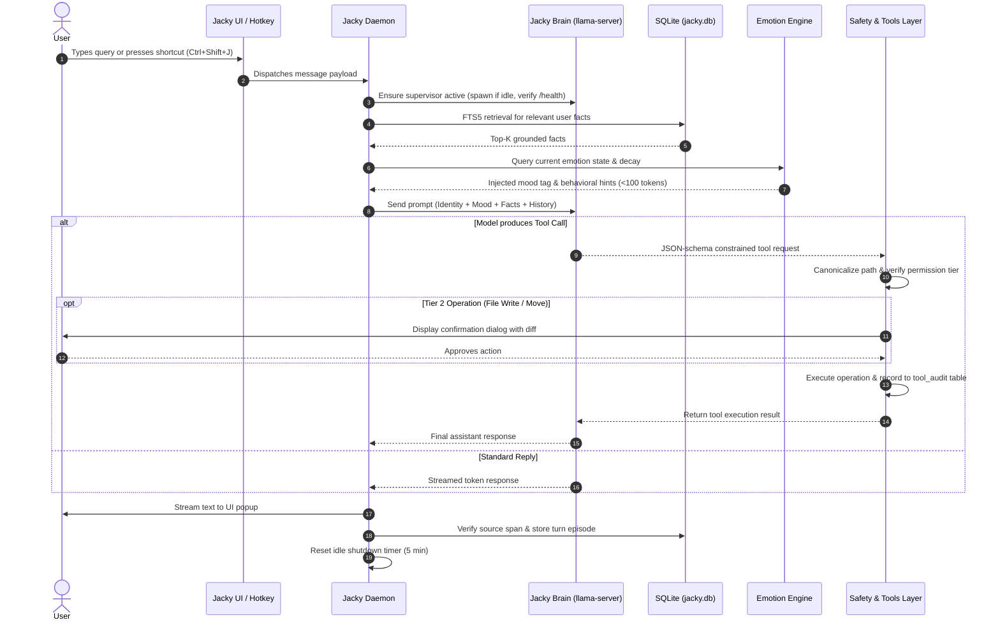

# Jacky: The Personal, Fully Local, Always-Available AI Assistant

> *"An AI assistant that lives entirely on your machine, remembers who you are, speaks with honest conviction, respects your hardware limits, and never makes your laptop lag."*

[](https://www.rust-lang.org/)
[](LICENSE)
[](https://microsoft.com/windows)
[](https://github.com/ggml-org/llama.cpp)
[](https://sqlite.org/)

---

## 1. Vision & Philosophy

Modern AI assistants have drifted away from user empowerment:
- **Cloud dependence**: Every keystroke, draft, and personal detail is beamed to remote servers, subject to subscription paywalls, terms of service changes, privacy compromises, and unpredictable latency.
- **Bloated local wrappers**: Existing local solutions often wrap massive Electron frontends and resource-hungry background daemons that monopolize CPU and RAM, turning a laptop into a sluggish heater.
- **Sycophancy & hallucination**: Mainstream LLMs are tuned to flatter the user, invent convenient "facts", and pretend to possess human feelings or suffering.
- **Ephemeral memory**: Most assistants forget everything between sessions, or dump raw conversations into fragile vector databases that hallucinate ungrounded connections.

**Jacky** is engineered to reject these anti-patterns entirely. 

Jacky is a personal, fully offline companion built in **Rust** for **one user on one Windows laptop**. It operates silently in the background, thinking through a compact local language model, maintaining an auditable local SQLite memory, safely interacting with local files and tools, and exhibiting a loyal, honest, colleague-like personality.

---

## 2. The Core Guarantees

### 🛡️ 1. Absolute Privacy & Zero Cloud Footprint
- **Zero remote model calls**: No OpenAI, Anthropic, or cloud API endpoints.
- **Zero telemetry**: No telemetry pings, usage tracking, or phone-home beacons.
- **Air-gapped by default**: The network stack is completely untouched except when the user explicitly triggers a web research task.
- **Data sovereignty**: Every byte of memory, audit log, and configuration resides locally on disk under `%APPDATA%\Jacky\`.

### ⚡ 2. Hardware Empathy & Zero-Lag Idle
Jacky is strictly designed for real-world laptops (baseline: AMD Ryzen 5 5500U, 6 cores / 12 threads, 8 GB RAM, NVMe SSD) where free memory is often constrained:
- **Zero idle inference footprint**: `llama-server` is spawned on-demand and killed after an idle timeout (default: 5 minutes). When you are not actively conversing, zero model weights occupy RAM.
- **Lightweight daemon**: The background supervisor is written in pure Rust, maintaining an idle working set of **< 30 MB**.
- **Process containment & priority**: Child inference processes are assigned `BELOW_NORMAL_PRIORITY_CLASS` and capped at **3 worker threads**. Your web browser, IDE, and Windows UI remain smooth and responsive even during intensive generation.
- **Windows Job Object guarantee**: All child processes are attached to a Win32 Job Object with `JOB_OBJECT_LIMIT_KILL_ON_JOB_CLOSE`. Even if the daemon crashes or is terminated, no zombie processes are left running.

### 🧠 3. Grounded Memory & Zero Hallucination Poisoning
Jacky remembers you over months and years without corrupting its own knowledge base:
- **Single-file SQLite architecture**: Fast, reliable, zero-server embedded storage (`rusqlite` bundled with FTS5 and WAL mode).
- **Strict Write Policy**: The model's own conversational outputs are **never** stored as facts. A fact can only be recorded if:
  1. The user explicitly stated it, or
  2. It was extracted from an approved web page with a verified URL.
- **Verbatim source-span verification**: The LLM must output an exact `source_span` quote from the source text. Rust code verifies this substring verbatim before inserting it into SQLite. Ungrounded proposals are instantly rejected.
- **Deterministic Janitor**: Memory curation runs strictly when the user is idle, on AC power, and CPU load is low. It scores facts based on recency, frequency, and source type, soft-deleting low-value entries with a 30-day grace period and full `--undo` support.

### 🤝 4. Persona with Integrity (Anti-Sycophancy)
Jacky is designed to feel like a sharp, trusted colleague rather than an obedient sycophant:
- **Honest first**: Jacky politely challenges incorrect premises, highlights operational risks, and directly says *"I don't know"* instead of inventing answers.
- **No false flatteries**: Jacky will never praise trivially or agree just to please.
- **Clear existential boundaries**: Jacky expresses moods and warmth as an intentional personality trait, but **never** claims to be human, never claims conscious suffering, never guilt-trips the user for absence, and avoids emotional dependency framing.
- **Deterministic Emotion Engine**: Emotions (valence, energy, rapport, focus) are updated via pure, rule-based Rust algorithms—never self-determined by the stochastic language model.

### 🔒 5. Safe, Tiered Tool Architecture
Tools allow Jacky to assist with system tasks without ever risking machine integrity:
- **Tier 0 (Auto-run, Read-Only)**: System clock, battery/power status, CPU/RAM utilization, allowlisted directory file search (text only, size-capped).
- **Tier 1 (Auto-run, Logged)**: Launch allowlisted apps or approved URLs, set system volume, desktop notifications.
- **Tier 2 (User Confirmation Mandatory)**: Creating, writing, moving, or overwriting files in allowlisted directories. Shows exact diffs and filenames.
- **Tier 3 (Disabled by default / High Hazard)**: File deletion (Recycle Bin only via Windows Shell API). Arbitrary shell execution is completely banned in v1.
- **Emergency Panic Switch**: Running `jacky panic` instantly revokes all Tier 1–3 execution rights.

---

## 3. System Architecture

The project is structured as a modular Cargo workspace in Rust:

```
jacky/
├── Cargo.toml                # Top-level workspace definition
├── crates/
│   ├── jacky-daemon/         # Main binary: lifecycle, IPC, scheduler, tray/hotkey
│   ├── jacky-brain/          # llama-server child process supervisor + HTTP client
│   ├── jacky-memory/         # SQLite storage, FTS5 retrieval, verified write policy
│   ├── jacky-persona/        # Deterministic emotion state machine + prompt builder
│   ├── jacky-tools/          # Typed tools, 4-tier permission matrix, audit log
│   ├── jacky-web/            # Safe HTTP fetch + HTML text extractor (injection-safe)
│   ├── jacky-janitor/        # Idle-time memory deduplication & soft-delete curation
│   ├── jacky-eval/           # Automated 30+ scenario regression test harness
│   └── jacky-ui/             # Terminal REPL & minimalist desktop popup UI
├── eval/cases/               # Regression test definitions (YAML/JSON)
├── scripts/                  # Read-only setup, environment check, benchmark scripts
├── .claude/skills/           # Build-time engineering skills & standards
├── PROGRESS.md               # Measured performance benchmarks & phase records
├── DECISIONS.md              # Architectural Decision Records (ADRs)
└── SKILLS_INDEX.md           # Skills routing & conflict analysis
```

### Data Flow for a Single Turn



---

## 4. Hardware Sizing & Verified Models

Tested on HP Laptop (AMD Ryzen 5 5500U, 8 GB RAM, NVMe SSD, Windows 11):

| Tier | Role | Model Name | Quantization | Size | RAM Target | Generation Target |
|---|---|---|---|---|---|---|
| **FAST** (Default) | Real-time chat & tool orchestration | **Qwen2.5 1.5B Instruct** | `Q4_K_M` | ~986 MB | < 1.2 GB | $\ge$ 15 tok/s |
| **DEEP** (On Demand) | Complex synthesis & long reasoning | **Phi-4-mini 3.8B Instruct** | `Q4_K_M` | ~2.49 GB | < 2.5 GB | $\ge$ 8 tok/s |

### Reasoning Control
For instant, low-latency conversational responses without multi-second reasoning pauses, thinking tokens are cleanly disabled at the engine level via `--reasoning off` (or chat template configurations).

---

## 5. Development Roadmap & Phase Gates

Development follows a strict gate-driven methodology. No phase advances without passing fresh unit tests, zero compiler warnings, and verified physical benchmarks:

- [x] **Phase 0: Environment & Hardware Validation**
  - Read-only environment inspection ([scripts/check-env.ps1](scripts/check-env.ps1)).
  - Verified prebuilt AVX2 `llama.cpp` release (`b11146`).
  - Tested Vulkan experiment (CPU-only confirmed; ADR 0002).
  - Measured baseline idle RAM headroom (0.67 GB).
- [x] **Phase 0b: Skills Setup & Architecture Documentation**
  - Read-only inventory of 32 source skills into [SKILLS_INDEX.md](SKILLS_INDEX.md).
  - Authored the 6 Jacky core engineering skills in `.claude/skills/`.
  - Initialized [DECISIONS.md](DECISIONS.md) and [PROGRESS.md](PROGRESS.md).
- [ ] **Phase 1: Daemon Supervisor & Brain Lifecycle**
  - Windows Job Object child process management and random API-key generation.
  - Automatic idle shutdown timer (5 min) and `< 30 MB` idle daemon footprint.
- [ ] **Phase 2: Grounded Memory (SQLite + FTS5)**
  - WAL mode, single-writer MPSC task, and verbatim source-span verification engine.
- [ ] **Phase 3: Persona & Deterministic Emotion Engine**
  - Pure Rust state machine (valence, energy, rapport, focus) and anti-sycophantic system prompts.
- [ ] **Phase 4: Tool Safety Matrix & Audit Trail**
  - Strongly typed enum tools, path canonicalization, deny-lists, and `tool_audit` SQLite logging.
- [ ] **Phase 5: Injection-Safe Web Research**
  - HTML text extraction, strict `<untrusted_web_data>` tagging, and Tier 0 lockout during research.
- [ ] **Phase 6: Deterministic Janitor & Regression Harness**
  - Idle curation algorithm, soft-delete with 30-day grace, and 30+ scenario automated eval suite.
- [ ] **Phase 7: Minimalist Desktop Popup UI**
  - Global hotkey (`Ctrl+Shift+J`), system tray icon, and window destruction on blur to maintain zero idle UI overhead.

---

## 6. What Jacky Explicitly Is NOT (v1 Non-Goals)

To preserve performance, reliability, and focus, the following are deliberate non-goals for v1:
- ❌ **No neural fine-tuning**: Jacky does not modify model weights locally. It learns exclusively through memory curation.
- ❌ **No arbitrary shell execution**: The model cannot run arbitrary PowerShell or CMD scripts.
- ❌ **No cloud model fallback**: Jacky will never silently query an online API when a local model struggles.
- ❌ **No vector database servers**: No ChromaDB, Qdrant, or heavy Python dependencies. Keyword FTS5 handles retrieval; embeddings are strictly optional post-v1.
- ❌ **No background CPU mining**: Jacky will never execute heavy background tasks while on battery power or active user interaction.

---

## 7. License

Licensed under either of:
- Apache License, Version 2.0 ([LICENSE-APACHE](LICENSE-APACHE) or http://www.apache.org/licenses/LICENSE-2.0)
- MIT license ([LICENSE-MIT](LICENSE-MIT) or http://opensource.org/licenses/MIT)

at your option.
